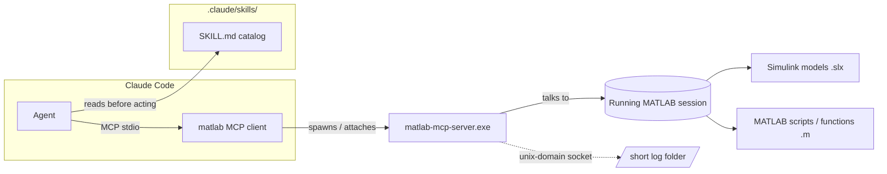

# matlab-mcp-guide

A practical, from-experience guide to connecting **Claude Code** to a local **MATLAB/Simulink** installation via the official MathWorks **Agentic Toolkit** (MCP server), plus how to lay out the **skills** and **project folders** so Claude actually uses the right tool for the right job.

This isn't marketing copy — it's the checklist I wish I'd had, written after actually wiring this up: the flags that matter, the ones that silently break on Windows, and the folder conventions that keep a large skill catalog usable instead of overwhelming.

## What you get out of this

- Claude Code can **read, edit, build, and simulate Simulink models** directly (no manual copy-pasting of block diagrams into chat).
- Claude Code can **run MATLAB code and test files** and get real command-window output back.
- A **skill catalog** (~150+ MathWorks-authored procedures) that Claude consults *before* improvising an approach — so it follows the vendor's recommended pattern for e.g. building a model programmatically instead of guessing at `add_block` calls.

## Architecture



The MCP server is a separate process that either **starts** a MATLAB session or **attaches** to one already running, then exposes a fixed set of tools (listed below) that Claude Code calls like any other tool.

## Prerequisites

- MATLAB installed locally (the guide below assumes Windows; paths differ on macOS/Linux but the logic is the same).
- Simulink, if you want the `model_*` tools — plain MATLAB works for the `evaluate_matlab_code` / `run_matlab_file` tools alone.
- Claude Code CLI installed and working.
- Know which toolboxes are actually **licensed** — the Agentic Toolkit will happily install, but individual skills silently fall back to "degraded" or "blocked" if the underlying toolbox isn't licensed (Simulink Test, Simulink Check, System Composer, Requirements Toolbox are common gaps). Run `detect_matlab_toolboxes` (see below) early to know what you're working with — don't assume.

## Step-by-step setup

### 1. Install the Agentic Toolkit from inside MATLAB

```matlab
setupAgenticToolkit("install")
```

This is a MathWorks-shipped function (ships with recent MATLAB releases). It:
- downloads/installs the MCP server binary into `~/.matlab/agentic-toolkits/bin/`
- can write the Claude Code MCP config for you directly with `Agents="claude-code"`:

```matlab
setupAgenticToolkit("install", Agents="claude-code")
```

Keep the toolkit itself up to date separately:

```matlab
setupAgenticToolkit("update")
```

**Gotcha:** re-running `setupAgenticToolkit("configure")` **overwrites `.mcp.json`** wholesale, including any manual flag tweaks you made (see step 2). Keep a backup of your working `.mcp.json` before touching this again.

### 2. Configure `.mcp.json` at your project root

A minimal, working config looks like this (see [`templates/.mcp.json.example`](templates/.mcp.json.example)):

```json
{
  "mcpServers": {
    "matlab": {
      "command": "C:/Users/<you>/.matlab/agentic-toolkits/bin/matlab-mcp-server.exe",
      "args": [
        "--log-folder=C:/mcplog",
        "--matlab-session-mode=auto"
      ]
    }
  }
}
```

Two flags here are **deliberate, not cosmetic** — both were the source of real failures:

- **`--log-folder`** — the server opens a **unix-domain socket** inside this folder. Unix-domain socket paths have a hard length limit. Point this at something short and writable like `C:/mcplog`. Pointing it at `%TEMP%` (which on Windows tends to be a long, deeply-nested path) fails with `socket path is too long`, and some temp locations fail outright with `access denied for socket file`. Create the folder once (`mkdir C:\mcplog`) and never move it.
- **`--matlab-session-mode=auto`** — `setupAgenticToolkit("configure")` defaults this to `existing`, which only works if a MATLAB session with `satk_initialize()` already run is sitting there waiting. `auto` starts a fresh MATLAB session itself when nothing is attached yet — much less fragile for day-to-day use. Re-apply this if a toolkit update resets it.

**Restart Claude Code after any `.mcp.json` edit** — MCP servers are loaded once at session start.

### 3. Auto-initialize MATLAB for the server

The MCP server starts MATLAB with its working folder set to wherever you point it. Drop a `startup.m` there (see [`templates/startup.m.example`](templates/startup.m.example)) that runs:

```matlab
satk_initialize();
addpath(genpath(pwd));
```

**Without `satk_initialize()`, every `model_*` tool fails** with `Unrecognized function or variable 'satk_initialize'` or similar — this is the single most common first-time failure. If you ever start MATLAB manually (not through the MCP server) and want the tools to attach to it (`--matlab-session-mode=existing`), you must run `satk_initialize()` yourself in that session first.

### 4. Verify the connection

From Claude Code, the first tool call in a session takes **~20–30 seconds** (cold start — spinning up MATLAB itself). Subsequent calls in the same session are fast. A good smoke test:

```
Ask Claude: "list installed MATLAB toolboxes"
```

This calls `detect_matlab_toolboxes` and tells you immediately what's actually usable versus just installed-but-unlicensed.

### 5. Know your 12 tools

| Tool | What it does |
|---|---|
| `evaluate_matlab_code` | Run arbitrary MATLAB code in the live session, get command-window output back |
| `run_matlab_file` | Execute a `.m` script file |
| `run_matlab_test_file` | Run a MATLAB unit test file via `runtests` |
| `check_matlab_code` | Static analysis (MATLAB's Code Analyzer) on a script — style/error/perf issues |
| `detect_matlab_toolboxes` | Report installed MATLAB + toolbox versions — settles licensing doubts in one call |
| `model_overview` | High-level Simulink model hierarchy (subsystems, interfaces, connections) |
| `model_read` | Inspect model structure/topology/expressions at a given scope + depth |
| `model_edit` | Structural changes: add/connect/configure/delete/replace blocks, create subsystems |
| `model_check` | Validate a model: unconnected ports/lines, Stateflow lint |
| `model_test` | Run Gherkin-format behavioral tests against a model |
| `model_query_params` | Random-access read of any block/signal/config parameter |
| `model_resolve_params` | Resolve a variable reference (e.g. `Kp`) from a model expression to its numeric value |

`model_edit` is flagged **destructive** — `.slx` files are binary, so an edit can't be diffed or manually undone the way a text-file edit can. **Commit before you let an agent touch a model** (see the git section below).

## Folder & skills layout

### Why a skills folder at all

Claude Code auto-discovers skills from `.claude/skills/` — short procedure files (`SKILL.md` + optional `references/`, `scripts/`) that tell the agent the *vendor-recommended* way to do something, instead of the agent inventing an approach from general MATLAB knowledge. For Simulink specifically this matters a lot: there are non-obvious idioms (see below) that produce working-but-wrong results if you skip them.

### Recommended layout

```
your-project/
├── .mcp.json                      # MCP server registration (step 2 above)
├── CLAUDE.md                      # project instructions + skill trigger table (see below)
├── .claude/
│   └── skills/                    # AUTO-DISCOVERED by Claude Code
│       ├── <vendor-skill-1>/      # symlink into ~/.matlab/agentic-toolkits/ (~150+ of these)
│       ├── <vendor-skill-2>/      # ...
│       ├── my-local-cheatsheet.md # a handful of REAL files: project-specific extras
│       └── my-custom-check/
└── skills/                        # optional: a human-readable backup copy, not auto-loaded
```

Two kinds of entries live in `.claude/skills/`:

1. **Symlinks into `~/.matlab/agentic-toolkits/`** — the vendor catalog, installed/managed by `setupAgenticToolkit`. Regenerate with `setupAgenticToolkit("update")`; **never hand-edit these** (they're not your files, and an update will blow away local changes anyway).
2. **Real local files** — project-specific procedures that aren't in the vendor catalog: quick cheat-sheets, custom Model Advisor checks, anything specific to *your* modeling conventions. These are yours; commit them.

Gitignore the symlinks (they're regeneratable, and Windows symlinks don't always travel well through git anyway), but track the real local files:

```gitignore
.claude/skills/
!.claude/skills/my-local-cheatsheet.md
!.claude/skills/my-custom-check/
```

(Simplify this if your local extras live in a dedicated subfolder instead of scattered among symlinks — e.g. ignore `.claude/skills/` wholesale and keep the real ones only in the `skills/` backup folder, symlinking them in separately.)

### The trigger table pattern

With 150+ skills available, the agent shouldn't have to guess which one applies. Put a trigger table straight in `CLAUDE.md` — see [`templates/CLAUDE.md.skills-section.example`](templates/CLAUDE.md.skills-section.example) for a full copy-paste starting point:

| Trigger in the request | Skill |
|---|---|
| "is the model compliant", MISRA / DO-178C / ISO 26262, Model Advisor run | `checking-model-compliance` |
| Build or edit a Simulink model programmatically | `building-simulink-models` |
| Run/configure a simulation | `simulating-simulink-models` |
| Write or run model tests | `testing-simulink-models` |
| "simulation is slow", compare two runs | `simulink-profiler-analyzer` |
| Solver errors, step size, algebraic loops | `simulink-solver-profiler-analyzer` |

This table does two jobs: it tells the agent *when* to stop and read a skill instead of improvising, and it doubles as a live index of what's actually relevant to your project versus the ~150 other skills in the catalog you'll never touch.

### Always-read cheat-sheets (no frontmatter, don't auto-load)

A few short idiom notes are worth keeping as **plain files** (not skills — no YAML frontmatter, so Claude Code won't surface them as invocable) that you tell the agent to read before *any* model-touching MATLAB:

- **Interaction shorthand** — "this block" = `gcb`, "this model" = `bdroot`, "this subsystem" = `gcs`.
- **Modeling idiom** — use `add_block` + `Simulink.BlockDiagram.arrangeSystem`; never hand-position blocks with pixel coordinates (it doesn't survive model evolution and looks awful diffed).
- **Simulation idiom** — always `out = sim(in)` with a `Simulink.SimulationInput` object; never `set_param` for simulation parameters (that mutates the model file itself instead of just configuring a run).
- **Baseline-before-editing** — capture a baseline simulation result *before* any model modification, so you can verify behavior didn't regress afterward. Without Simulink Test licensed, this is just `sim()` + `assert` instead of `sltest.TestCase` — degraded, not blocked.

### Which skills can actually run — license reality check

Not every skill in the catalog will work — it depends entirely on what's licensed. Build a table like this once per project and keep it current (`detect_matlab_toolboxes` settles any doubt in one call — never fake output for a blocked skill):

| Category | Status | Blocker |
|---|---|---|
| Core modeling/sim/build skills | Usable | — (just needs Simulink) |
| Spec/plan-writing skills | Usable | Templates only, no toolbox needed |
| Requirements drafting | Degraded | No Requirements Toolbox → YAML fallback instead of `.slreqx` |
| Model testing | Degraded | No Simulink Test → plain `sim` + `assert` instead of `sltest.TestCase` |
| Compliance checking | Blocked | No Simulink Check → no Model Advisor |
| Architecture modeling | Blocked | No System Composer |

When a skill is blocked, the right move is to say so and stop — not to fabricate what Model Advisor or System Composer *would* have said.

## Git hygiene for Simulink projects

Two config files matter more than usual here because `.slx` is a binary, XML-zip-under-the-hood format that **Windows CRLF conversion will silently corrupt** if git treats it as text:

`.gitattributes` (see [`templates/.gitattributes.example`](templates/.gitattributes.example)):
```gitattributes
*.slx   binary
*.slxc  binary
*.mat   binary
*.mlx   binary
```

`.gitignore` — exclude build/cache artifacts that regenerate on every run:
```gitignore
slprj/
sccprj/
codegen/
*.slxc
*.autosave
*.asv
```

**Commit before every model-touching session.** Since `model_edit` can't be diffed or manually reverted the way a text edit can, a clean commit right before you start is your only real undo button. If there's no commit history yet at all, make an initial baseline commit before the first agent-driven edit — entirely local, nothing sent anywhere.

## Troubleshooting quick-reference

| Symptom | Cause | Fix |
|---|---|---|
| Every `model_*` tool fails with "Unrecognized function or variable" | `satk_initialize()` never ran in the MATLAB session | Add it to `startup.m` in the server's working folder, or run it manually if attaching to an existing session |
| `socket path is too long` | `--log-folder` points somewhere deeply nested (e.g. default temp) | Point it at a short path like `C:/mcplog` |
| `access denied for socket file` | Log folder isn't writable, or is a redirected/synced folder (OneDrive, etc.) | Use a plain local folder with normal write permissions |
| `.mcp.json` reverted your custom flags | `setupAgenticToolkit("configure")` was re-run | Keep a backup copy; reapply your flags after any toolkit reconfigure |
| First tool call hangs for ~20-30s then works | Cold start — MATLAB itself is booting | Normal; only the first call per session pays this cost |
| A skill produces suspiciously confident output for something you know isn't licensed | Skill degraded silently instead of stopping | Run `detect_matlab_toolboxes` to confirm; treat unexpected success with suspicion |

## Templates in this repo

- [`templates/.mcp.json.example`](templates/.mcp.json.example) — working MCP server registration
- [`templates/startup.m.example`](templates/startup.m.example) — auto-init script for the MATLAB working folder
- [`templates/CLAUDE.md.skills-section.example`](templates/CLAUDE.md.skills-section.example) — drop-in skills section + trigger table for your own `CLAUDE.md`
- [`templates/.gitattributes.example`](templates/.gitattributes.example) — binary handling for Simulink/Office/PDF files
- [`templates/.gitignore.example`](templates/.gitignore.example) — build artifacts + vendor skill symlinks

## License

MIT for the contents of this guide and its templates. The Agentic Toolkit itself is MathWorks-authored and BSD-3-Clause licensed — this repo doesn't redistribute it, only documents how to set it up.
